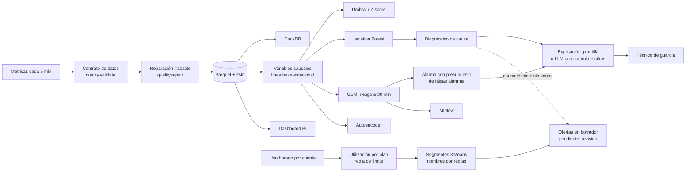

# capacity-guard


**capacity-guard avisa con antelación cuando un servidor de hosting está a punto de saturarse** y explica por qué.
También analiza a los clientes: detecta las cuentas que se acercan al límite de su plan y prepara borradores de ofertas
comerciales, que siempre revisa una persona antes de enviarse. El proyecto cubre todo el recorrido: lectura y limpieza
de los datos, modelos de machine learning, un dashboard y explicaciones de cada alarma que pueden redactarse con IA,
descartando cualquier texto con cifras que no estén en los datos.

🔗 **Dashboard:** [capacity-guard.streamlit.app](https://capacity-guard.streamlit.app/)

A partir de métricas cada 5 minutos (CPU, RAM, iowait, red, load, peticiones/min), el sistema:

1. detecta comportamientos anómalos respecto a lo normal para esa hora de la semana,
2. estima la probabilidad de que un servidor **sature en los próximos 30 minutos**,
3. diagnostica la causa más probable (vecino ruidoso, fuga de memoria, fuerza bruta, disco, pico legítimo) y
4. explica la alarma al técnico de guardia con datos verificables y
5. detecta las cuentas de clientes que rozan el límite de su plan y redacta borradores de ofertas comerciales.

**Avisa y sugiere, pero no actúa por su cuenta: las decisiones son de las personas. Las ofertas se quedan en borrador
(`pendiente_revision`) hasta que alguien las aprueba.**

## Usar tus propios datos

```bash
python -m capguard validate-csv --metrics mis_metricas.csv --out outputs/data
python -m capguard all --source csv --metrics mis_metricas.csv --out outputs
python -m capguard score --input mis_metricas.csv --model outputs/model.joblib
```

Al leer el CSV acepta alias de columnas, separadores `,` `;` y tabulador, UTF-8 o latin-1, coma decimal y separador de
miles (`1.234,56`), fracciones en lugar de porcentajes, fechas día/mes (si son ambiguas exige `--date-format`), datos
cada minuto (se agregan a 5) y mapeos explícitos con `--mapping mapping.json`. Lo que no puede interpretar lo rechaza
con un mensaje que dice qué columna falla y por qué; nunca inventa huecos largos ni etiquetas. Sin columna `event` se
omiten, con aviso, la evaluación de incidentes y el diagnóstico. Con `--accounts` y `--usage` se activa el análisis de
clientes. Hay CSV de ejemplo en [`examples/`](examples/) y el formato está en [`docs/DATA_FORMAT.md`](docs/DATA_FORMAT.md).

## En 30 segundos

| | |
|---|---|
| **Problema** | Los umbrales fijos (CPU > 85 %) avisan tarde o demasiado: la guardia se entera cuando el cliente ya lo nota. |
| **Enfoque** | Compara cada métrica con lo normal para ese servidor a esa hora de la semana y entrena un modelo (gradient boosting) que estima el riesgo de saturación. El umbral de alarma se ajusta para no pasar de un **número máximo de falsas alarmas**, y se evalúa **por incidente** (¿se avisó? ¿con cuántos minutos de margen?), no solo por muestra. |
| **Resultado (simulado)** | Repetido en 3 mundos simulados, el GBM avisa con ≥10 min de antelación del 41 % ± 9 de las saturaciones, frente al 37 % del z-score estacional y el 23 % del umbral fijo, y con menos falsas alarmas que el z-score (0,42 frente a 0,46 por servidor y día). En walk-forward (3 periodos futuros) también es el mejor: 35 % ± 10 frente a 27 % ± 16. No gana en todos los mundos: en la semilla principal el z-score avisa más (41 % frente a 33 %). |
| **Clientes** | Detecta las cuentas que rozan repetidamente el límite de su plan (52 de 320), las agrupa en segmentos interpretables (ARI 0,95 frente a los perfiles simulados) y redacta ofertas en borrador para revisión humana; las cuentas con causa técnica nunca reciben una venta. |
| **Rigor** | Partición temporal, test de causalidad de las variables, walk-forward, calibración, importancia por permutación, prueba con etiquetas barajadas, repetición con varias semillas y validación sobre datos reales públicos (NAB). |
| **Ingeniería** | Paquete Python con CLI, 73 tests (unitarios, extremo a extremo y del dashboard), lint, CI en GitHub Actions (3 versiones de Python + build de Docker), dependencias bloqueadas, MLflow, Parquet + DuckDB. |

> Todos los datos de entrenamiento son **simulados** (ciclos diarios/semanales, backups nocturnos, incidentes
> etiquetados y picos de tráfico legítimos; la carga de cada servidor es la suma del uso de sus cuentas de clientes). Las cifras demuestran que el método funciona sobre lo simulado; no son una
> promesa sobre producción. Por eso hay una comprobación aparte con series reales de AWS CloudWatch (benchmark NAB).

## Arquitectura



Decisiones de diseño: [`docs/ARCHITECTURE.md`](docs/ARCHITECTURE.md) · preguntas frecuentes: [`docs/FAQ.md`](docs/FAQ.md).

## Qué demuestra y cómo se comprobó

| Disciplina | Qué hay | Cómo se verificó |
|---|---|---|
| **Ingeniería de datos** | Contrato de datos y reparación trazable (`quality.py`, `ingest.py`), Parquet + DuckDB (`store.py`) | Se corrompe un feed (duplicados, nulos, valores imposibles, huecos) y se mide el error de la reparación contra la verdad oculta |
| **Clientes y ofertas** | Utilización por plan, regla auditable validada hacia delante, KMeans estable con nombres por reglas, exclusión de cuentas con causa técnica y ofertas en borrador (`segments.py`, `offers.py`) | Ninguna cuenta holgada marcada, ARI frente a los arquetipos simulados, nunca una venta a cuentas técnicas (con y sin etiquetas), textos sin cifras inventadas |
| **Big data** | Mismas variables con pandas y con DuckDB hasta ~26 M de filas (`scale.py`) | Un test exige resultados idénticos entre ambos motores y el pipeline de modelado; memoria pico medida por proceso |
| **Análisis de datos** | EDA de incidentes y modelo de coste con análisis de sensibilidad (`analysis.py`) | Tests de la aritmética de costes y de que el EDA coincide con la verdad-terreno |
| **Business Intelligence** | Dashboard Streamlit de 7 pestañas (incluida «Clientes») con filtros y costes editables (`dashboard/`) | Test sin navegador (AppTest) con interacciones reales: cambiar servidor, rango, sliders y filtros de ofertas |
| **Machine learning** | Variables causales, GBM, evaluación por evento, walk-forward, calibración, importancia por permutación, diagnóstico multiclase | Test de causalidad; walk-forward en 3 periodos; con etiquetas barajadas el diagnóstico cae al nivel del azar |
| **Deep learning** | Autoencoder sobre ventanas de 1 h (`deep.py`) | Mismo protocolo que el resto; **no gana** y se reporta |
| **IA generativa** | Explicación de alarmas: hechos medidos → texto; LLM opcional; si su texto trae alguna cifra que no está en los datos, se descarta y se usa la plantilla (`explain.py`) | Tests con cliente simulado: cifra inventada, cifra truncada, respuesta cortada y caída del servicio |
| **MLOps** | MLflow, modelo versionado con las versiones de sus librerías, Docker, CI, `requirements.lock` | CI construye la imagen y comprueba que el dashboard responde; `scripts/verify.sh` reconstruye todo desde cero |

**Stack:** Python · pandas · NumPy · SciPy · scikit-learn · DuckDB · PyArrow/Parquet · MLflow · Streamlit · Plotly ·
Matplotlib · Anthropic API · pytest · ruff · Docker · GitHub Actions.

## Ejecutarlo

**Con Docker** (no necesita Python local):

```bash
docker build -t capacity-guard .          # genera modelo, datos e informe dentro de la imagen
docker run --rm -p 8501:8501 capacity-guard
# abrir http://localhost:8501
```

**En local** (Python 3.11+):

```bash
python -m venv .venv && source .venv/bin/activate
pip install -r requirements-dev.txt       # o requirements.lock para las versiones exactas de Docker/CI
python -m capguard all --real             # ~1 min en 32 vCPU: genera outputs/ (informe, datos, modelo, resultados)
streamlit run dashboard/app.py            # dashboard interactivo
python -m pytest -q                       # batería de tests
```

El informe completo, con todas las figuras, se genera en `outputs/report.html` (fichero autocontenido). Los ficheros
generados (informe, Parquet, modelo) no se versionan en git: en el repositorio solo están `outputs/results.json`,
`outputs/RESULTS.md` y `outputs/real_results.csv`, de donde salen las cifras de este README. El dashboard usa `outputs/` si
has ejecutado `python -m capguard all` (Docker lo hace al construir la imagen); si no, muestra la instantánea de
demostración versionada en `demo/`, con un aviso. `--real` descarga 9 series públicas de AWS CloudWatch; sin red,
todo lo demás funciona.

**Desplegar el dashboard en Streamlit Community Cloud:** basta con indicar `dashboard/app.py` como fichero principal
y Python 3.12. Streamlit Cloud clona el repositorio sin `outputs/data` y no ejecuta el pipeline, así que el dashboard
muestra `demo/`: una instantánea de ~4 MB de los mismos resultados del README (solo las columnas que lee el
dashboard y el uso de las cuentas con oferta; sin el modelo serializado). Arranca en segundos y no entrena nada.
Tras cambiar el pipeline, `make all` regenera resultados, README y demo; un test falla si `demo/` queda desfasada.

**Puntuar métricas propias** con el modelo entrenado:

```bash
python -m capguard score --input mis_metricas.csv --out alertas.csv
# columnas: timestamp,server,cpu,ram,iowait,net,load1,req  (una fila cada 5 min por servidor)
```

Los datos de entrada pasan por el mismo contrato de calidad (duplicados y huecos cortos se reparan) y los servidores que
el modelo no vio al entrenar se puntúan con el perfil medio de la flota, con un aviso: para producción conviene
reentrenar con su propio histórico.

**Explicaciones con un LLM** (opcional): `export ANTHROPIC_API_KEY=… && python -m capguard all --llm`. Usa
`claude-haiku-5-5` por defecto (configurable con `CAPGUARD_LLM_MODEL`); sin clave se usa la plantilla determinista.

Atajos en el [`Makefile`](Makefile): `make test`, `make lint`, `make all`, `make demo`, `make docker`, `make verify` (entorno
limpio desde cero). Todos los subcomandos: `python -m capguard --help`.

## Resultados

<!--RESULTS-->
*Generado por `python -m capguard all` · semilla 7 · 8 servidores × 45 días · datos simulados.*

**Aviso temprano de saturación (30 min), periodo de test, presupuesto ≤ 0.5 falsas alarmas por servidor y día en validación:**

| Método | Saturaciones avisadas ≥10 min antes | Falsas alarmas / servidor·día |
|---|---|---|
| Umbral estático | 23 % | 0.04 |
| Z-score estacional | 41 % | 0.41 |
| Isolation Forest | 28 % | 0.50 |
| Pronosticador GBM | 33 % | 0.29 |
| Autoencoder (deep learning) | 13 % | 0.60 |

**Robustez: el mismo experimento en 3 mundos simulados distintos (semillas 8, 9, 10):**

| Método | Avisadas ≥10 min antes (media ± desv.) | Falsas alarmas / servidor·día |
|---|---|---|
| Umbral estático | 23 % ± 6 | 0.06 ± 0.04 |
| Z-score estacional | 37 % ± 6 | 0.46 ± 0.13 |
| Isolation Forest | 30 % ± 6 | 0.67 ± 0.36 |
| Pronosticador GBM | 41 % ± 9 | 0.42 ± 0.04 |

**Validación walk-forward (3 periodos futuros):**

| Método | Avisadas ≥10 min antes (media ± desv.) | Falsas alarmas / servidor·día |
|---|---|---|
| Umbral estático | 17 % ± 7 | 0.04 |
| Z-score estacional | 27 % ± 16 | 0.45 |
| Isolation Forest | 18 % ± 17 | 0.46 |
| Pronosticador GBM | 35 % ± 10 | 0.48 |

**Coste con supuestos ilustrativos (no avisar 200 €, falsa alarma 15 €, avisar a tiempo 20 €):**

| Método | Coste en test (€) | Ahorro vs umbral |
|---|---|---|
| Umbral estático | 6,240 | 0 % |
| Z-score estacional | 5,475 | 12 % |
| Isolation Forest | 6,495 | -4 % |
| Pronosticador GBM | 5,850 | 6 % |

- **Calidad de datos:** el feed sucio falla 6 comprobaciones y tras reparar pasa el contrato; 5 de 103,680 filas irrecuperables; error de imputación ≤ 13 % de la desviación típica.
- **Diagnóstico de causa:** 97 % de acierto al saltar la alarma (predecir siempre la clase mayoritaria: 22 %; con etiquetas barajadas 16 %). Las firmas simuladas son limpias: con datos reales hay que esperar menos.
- **Calibración isotónica:** Brier 0.0080 → 0.0079 (mejora).

**Prueba de escala (4 variables de producción; pandas vs DuckDB sobre Parquet):**

| Escala | Motor | Tiempo (s) | Memoria pico (MB) | Máquina | Origen |
|---|---|---|---|---|---|
| 864,000 filas | pandas | 0.52 | 432 | 32 vCPU, 47 GB RAM | esta ejecución |
| 864,000 filas | duckdb | 0.09 | 464 | 32 vCPU, 47 GB RAM | esta ejecución |
| 3,888,000 filas | pandas | 5.04 | 1055 | 1 vCPU, 3 GB RAM | medición previa (docs/scale_benchmark.json) |
| 3,888,000 filas | duckdb | 2.99 | 739 | 1 vCPU, 3 GB RAM | medición previa (docs/scale_benchmark.json) |
| 25,920,000 filas | duckdb | 20.83 | 3468 | 1 vCPU, 3 GB RAM | medición previa (docs/scale_benchmark.json) |

- **Clientes cerca de su límite:** 52 de 320 cuentas marcadas; 45 borradores comerciales, todos en `pendiente_revision` (nada se envía solo); 10 cuentas con causa técnica excluidas de cualquier venta; 6 segmentos (campanas, campanas_2, campanas_3, crecimiento, esporadico, intensivo); ARI frente a los arquetipos simulados 0.95; precisión hacia delante de la regla 80 % (ingenua 73 %). La aceptación de las ofertas es un supuesto ilustrativo.
<!--/RESULTS-->

**Datos reales (NAB, AWS CloudWatch):** un detector univariante sencillo detecta 10 de 16 ventanas de anomalía
etiquetadas por humanos. Es solo una comprobación del enfoque fuera de la simulación (el benchmark no contiene
saturaciones de hosting y los parámetros se eligieron mirando esas mismas series), detallada en el informe.

## Lo que no hace (límites)

* **Datos sintéticos.** El simulador es más limpio que la realidad; sobre todo el diagnóstico de causa (firmas muy
  distintas entre sí) rendiría bastante peor con datos reales.
* **El presupuesto de falsas alarmas no se transfiere exactamente** de validación a test: varios métodos lo superan algo.
* **No todo se puede prever.** La fuerza bruta llega de golpe; ahí el valor es detectar rápido y mitigar, no predecir.
* **La ventaja del GBM sobre el z-score estacional es moderada y no se da en todos los mundos simulados**: en media gana
  por 4 puntos con menos falsas alarmas, pero en la semilla principal el z-score avisa más. La clara es frente al umbral fijo.
* **Los costes en euros son supuestos de ejemplo.** Con ellos, en la semilla principal el z-score sale algo más barato que
  el GBM; con falsas alarmas caras, el umbral estático es la mejor opción.
* **Clientes:** los arquetipos simulados son limpios (de ahí el ARI de 0,95); con clientes reales los segmentos serán más
  difusos. La tasa de aceptación de las ofertas es un **supuesto ilustrativo**, no un dato. Sin etiquetas de incidentes,
  la guarda técnica se aproxima con el uso por encima del límite del plan.
* **Datos reales sin etiquetas:** sin columna `event` no hay detección de incidentes ni diagnóstico evaluables.
* **El LLM real no se ha ejecutado** en esta entrega (no había clave); su ruta se verificó con un cliente simulado.
* **Escala:** probado hasta ~26 M de filas en una máquina de 1 vCPU / 3 GB (medición previa guardada en
  `docs/scale_benchmark.json`, no se repite en cada ejecución; se tomó con el método de memoria anterior, que podía
  sumar el pico del proceso padre, así que la memoria de DuckDB de esas filas puede estar sobreestimada). Spark o un
  almacén en la nube no se han probado.
* **Reproducibilidad entre versiones:** las cifras son deterministas con la semilla y las versiones de `requirements.lock`;
  con otras versiones de scikit-learn pueden variar unos puntos.
* **Fallo nativo intermitente abierto (sin resolver).** En la máquina de desarrollo (WSL2, 32 vCPU) aparecen de vez en
  cuando segfaults o `MemoryError` imposibles: en unas tandas en ~1 de cada 2 ejecuciones de los tests y en otras en
  ninguna. Ocurre con CPython 3.12.11, 3.12.15 y 3.13.16 y llega a darse en un proceso que **solo importa** numpy,
  pandas, scipy, scikit-learn, pyarrow y duckdb, sin ejecutar código del proyecto, por lo que no parece venir de él;
  limitar los hilos nativos no lo ha eliminado de forma demostrable. No se ha podido probar en Docker ni en la CI de
  GitHub (es la primera comprobación pendiente tras subir el repositorio). Si lo ves, relanza; si se repite, prueba con
  `OPENBLAS_NUM_THREADS=1 OMP_NUM_THREADS=1`.
* El autoencoder usa scikit-learn (MLP), no PyTorch.

## Estructura

```
capguard/
  schemas.py sources.py              esquemas canónicos e ingesta de CSV reales (normalización, capacidades)
  ingest.py quality.py store.py      ingeniería de datos: feed sucio, contrato, reparación, Parquet/DuckDB
  accounts.py segments.py offers.py  cuentas y planes, clientes cerca de su límite, segmentos y ofertas en borrador
  simulator.py features.py           datos simulados y variables causales
  models.py pipeline.py evaluation.py  cuatro detectores, calibración de alarmas y evaluación por evento
  validation.py                      walk-forward, calibración, importancia
  deep.py diagnosis.py explain.py    autoencoder, causa probable, explicación con control de cifras
  analysis.py scale.py real.py       negocio/costes, prueba de escala, validación con datos reales
  orchestrate.py report*.py summary.py  pipeline completo, informe HTML y resumen para este README
  bundle.py tracking.py __main__.py  modelo serializado, MLflow y CLI
dashboard/app.py                     BI interactivo (Streamlit); fichero principal para desplegarlo
demo/                                instantánea pequeña de resultados para el dashboard desplegado
tests/                               unitarios, extremo a extremo, CLI y dashboard
docs/                                arquitectura, formato de datos, preguntas frecuentes, benchmark de escala
examples/                            CSV de ejemplo (métricas limpias y «sucias», cuentas, uso y planes)
outputs/                             resultados generados; en git solo results.json, RESULTS.md y real_results.csv
requirements.txt / requirements.lock dependencias (rangos verificados / versiones exactas)
```

## Licencia

[MIT](LICENSE) © 2026 Carlos Manuel Suárez Rivero (CMSR92)

## Autor

**Carlos Manuel Suárez Rivero (CMSR92)** · [LinkedIn](https://www.linkedin.com/in/cmsr92) · [Portfolio](https://carlosmsr92.github.io/cmsr92/)
