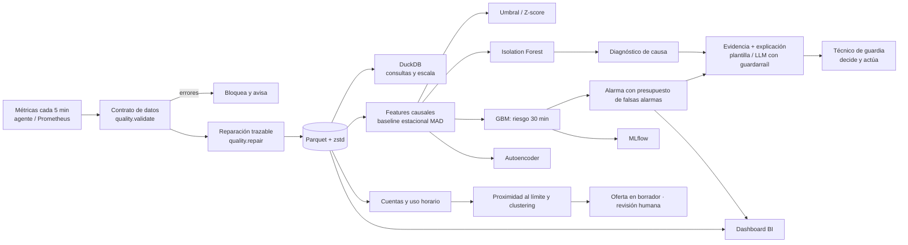

# Arquitectura

## Decisiones

* **Evaluación por evento**: ¿saltó la alarma?, ¿con cuántos minutos de antelación?, ¿cuántas falsas alarmas por día?
* **Partición temporal** y variables **causales** (un test lo comprueba); walk-forward para ver la estabilidad.
* **Umbrales por presupuesto de falsas alarmas** calibrado en validación, no cifras arbitrarias.
* **Fallos visibles**: los datos malos se miden y se reparan con rastro (`imputed`), los huecos largos no se inventan,
  el LLM nunca puede publicar una cifra que no esté en la evidencia.
* **Humano en el bucle**: el sistema no actúa solo ni atiende al cliente.
* **Clientes**: las causas técnicas bloquean la venta; todo borrador queda en `pendiente_revision`.

## Datos por cuenta

La carga de cada servidor simulado es la suma del uso de CPU de sus cuentas dividida por la capacidad de un servidor
típico (escala fija para toda la flota): un servidor con clientes más intensivos está de verdad más cargado.

`segments.py` trabaja siempre en **utilización** (uso / límite del plan): marca las cuentas que en los últimos 14 días
han pasado ≥ 5 días por encima del 85 % de algún límite o ≥ 3 días limitadas, valida la regla hacia delante (¿siguen
cerca del límite las 2 semanas siguientes?, frente a una regla ingenua), agrupa las marcadas con KMeans (k por silueta
entre los k estables) y nombra cada grupo con reglas fijas sobre su centroide, más un árbol sustituto legible.

Las cuentas con causa técnica (incidente atribuido o, sin etiquetas, uso por encima del límite del plan) se excluyen
del clustering y nunca reciben una venta. `offers.py` aplica una política determinista (upgrade, ampliación temporal,
consejo, plan máximo) con tope de descuento, enfriamiento entre ofertas y antigüedad mínima; los textos pasan el mismo
guardarraíl de cifras que las alarmas y todo queda en `pendiente_revision`. Los CSV sin datos de cuentas omiten esta
capacidad sin inventar información.

## Producción (no implementado aquí)

Puntuación por lotes cada 5 min desde Prometheus con `capguard score`, reentrenamiento semanal con walk-forward como
puerta de calidad, y revisión del presupuesto de alarmas con el equipo de guardia.
